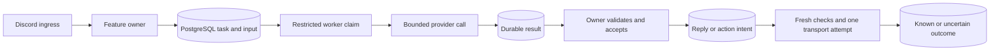

# Yuna

Yuna is a Discord assistant with durable conversations, approved server knowledge, configurable text moderation, staff controls, personal usage limits consented private memory and structured debates. The bot and provider worker run separately, using PostgreSQL to record claims, decisions, delivery intent and uncertain outcomes. See [Yuna.md](Yuna.md) for implementation boundaries and verification.

Start with [local setup](docs/LOCAL_TEST.md), choose a [configuration template](config/README.md), and use the [operations guide](docs/OPERATIONS.md) for health checks, supervision and backup/restore. No service starts and no Discord command is registered merely by installing dependencies or building the project.

## Starter behavior

- Conversations respond to direct mentions/replies. Approved knowledge is retrieved only for the permitted channel and checked again before provider disclosure, result acceptance and sending.
- The moderation template covers text harassment, threats, privacy violations and scams. It warns for established violations and takes no action for suspicion or uncertainty. Owners can configure ban mappings explicitly.
- The starter allows ten member-requested provider attempts and 1,000 total server attempts per UTC day. A separate budgeted template supplies $0.50 member and $5 server limits; verified model prices are required before capped calls run.
- Debates require both participants to consent to a complete scope, rubric, publication audience and paying initiator. Only explicit submissions are assessed; results confer no permissions or moderation consequences.
- Memory is private and based on explicit member submissions. Consent, inspection/search and forgetting are separate commands. It is not silently extracted from chat or added to public conversation context.

The templates choose models through environment selectors, so rules and quotas do not depend on a particular model name. The active provider routes support DeepSeek chat and OpenRouter Decisions. An optional OpenRouter embedding adapter is implemented separately; Memory has no embedding task or retrieval route enabled. A different provider protocol needs its own reviewed adapter and execution contract.

Optional kick execution, multi-custodian approval methods and bounded artifact storage are implemented at component level. Command registration, governance schema/provisioning and media/semantic workflows remain separate integration work. See [the method guide](Yuna.md#optional-component-methods-completed-on-28-october) for exact ownership and limits.

## Run and verify

Node 24 or newer and PostgreSQL server tools are required for the complete test suite.

```sh
npm ci
npm run build
npm run check:docs
npm run test:all
```

Prepare role-specific `.env` files from the examples, then follow the local guide before running:

```sh
npm run db:prepare
npm run register:commands
npm run local:worker
```

Run `npm run local:bot` in a separate terminal. `db:prepare` uses an administrator connection; the bot and worker never apply migrations at startup. `register:commands` upserts only the Yuna guild command. Fake providers need no API keys and incur no provider charges. Fake assessments stay uncertain and cannot authorize sanctions.

Use `/yuna bootstrap` as the current guild owner, then `/yuna configure` to approve the selected configuration file. `/yuna status` reports installation and policy revisions. Members use `/yuna usage`, `/yuna limit` and `/yuna limit-clear` for their own allowances. Staff capabilities remain explicit and scoped; native Discord permissions alone do not enroll a moderator in Yuna.

## Find your way through the code

| Start here | Purpose |
| --- | --- |
| [Yuna.md](Yuna.md) | Function guide, data flow, implementation reasons, verification and remaining optional scope. |
| [CONTRIBUTING.md](CONTRIBUTING.md) | How to make a small change, document it and verify its boundaries. |
| [apps/bot/bot.module.ts](apps/bot/bot.module.ts) | Composition root: connects Discord, feature owners, maintenance and cleanup. |
| [apps/ai-worker/ai-worker.module.ts](apps/ai-worker/ai-worker.module.ts) | Bounded worker lanes and explicit provider routes. |
| [src/contexts](src/contexts) | Business owners: Administration, Community, Moderation, Memory and Debates. |
| [src/discord](src/discord) | SDK normalization, native facts and narrow outbound transports. No business entity access. |
| [src/ai](src/ai) | Bounded provider adapters and versioned capability input/output contracts. |
| [src/platform/jobs](src/platform/jobs) | Durable tasks, prepared inputs, attempts, results, acknowledgments and wake-up hints. |
| [src/platform/usage](src/platform/usage) | Exact accounting, personal limits and conservative unresolved reservations. |
| [src/platform/db/migrations](src/platform/db/migrations) | Reviewed schema upgrades and restricted worker SQL entry points. |
| [tests/README.md](tests/README.md) | Unit, integration, concurrency and operational verification. |

Every TypeScript file starts with its purpose; named functions and methods explain their role. `check:docs` catches missing comments, while code review checks that the explanations remain accurate. JSON settings are explained in the adjacent configuration guide because standard JSON does not permit comments. Historical migration checksums are preserved.

## How work moves through Yuna



The owner decides what the result means. A model cannot grant permissions, select a sanction target, choose the next workflow stage or call Discord. Input disclosure, owner acceptance and external dispatch each recheck the relevant bindings. Notifications only wake consumers; database state remains authoritative.

A timeout does not mean an operation failed. Unknown provider spend stays reserved, and an unknown Discord send/sanction is reconciled by exact attributable evidence. Yuna does not promise exactly-once remote effects or blindly resend after losing a response.

## Moderation scope

Original-message capture is independent of conversation replies. Edits and deletions do not replace retained original evidence. Reports are allegations and cannot manufacture an original message. Text observation is followed by typed rule assessment; the owner applies explicit exclusions, evidence requirements and action mappings. Multiple rules share one observation and produce separately bound findings before one final action is selected.

Staff ban/unban admission checks the current native permissions, scoped Yuna grant, actor and exact target. Unban requires an explicit request by a current Discord administrator. Automatic policy actions preserve the accepted findings and exact allowed operation. Shared target execution prevents conflicting sanctions across installation generations. Discord role hierarchy and permissions are checked before dispatch.

The initial route covers one original text message. It does not inspect image contents, detect coordinated raids, aggregate spam rates or infer recurring misconduct from warnings. A harmless original later edited into harmful text is outside the original-only evidence policy. These are explicit optional extensions, not protections established by passing tests.

## Operating boundaries

Run one bot owner per guild. PostgreSQL session ownership enforces this restriction. Worker concurrency is shared across routes; start with one lane and use observed queue/provider timings before raising it. Logs contain bounded operational classifications and reference IDs, not message bodies or credentials.

Retention erases eligible payloads and metadata in bounded batches. Removal fences new work first and records every enabled owner's cleanup disposition. Unresolved charges/effects and lineage/deduplication records may retain minimal references according to the documented owner policy; retained metadata is never presented as erased.

Tests use fake external adapters and isolated PostgreSQL databases. They verify lifecycle and authorization behavior, not the quality of a live model or production throughput. Live Discord/provider acceptance and deployment checks remain operator work described in the setup and operations guides.
