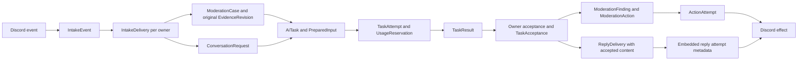

# Yuna entity model plan

This reference defines the 40 implemented entity models, their writers, keys, lifecycles and data ownership. Entity classes, local transition methods, PostgreSQL mappings and executable tests are implemented. Service orchestration remains planned, and no deployment migrations have been applied. Shared SQL constraints supplement ORM mappings; generate them through `createEntitySchemaSql`, not the ORM generator alone.

The first release covers guild message moderation, Community replies, authenticated staff operations, durable execution and cleanup. Memory, Debates, multi-custodian governance and kick remain staged. The companion [architecture plan](ARCHITECTURE_PLAN.md) defines execution rules; [DTO and module reference](DTO_REFERENCE.md) defines application boundaries.

## Selected modeling decisions

- **Moderation assesses only original message content.** A retained, attributable `MESSAGE_CREATE` capture is the original. An edit, deletion, report, or later REST fetch cannot substitute a different body. Missing original content produces incomplete evidence, not inferred misconduct. Reports refer to the same original-message case. Human staff operations remain a separate authorized path.
- Original evidence and current source state answer different questions. Edits/deletion invalidate Community work that requires a current message; they do not alone invalidate a moderation task bound to retained original evidence. Policy changes, capture corrections, retention, permissions, installation state and safety can still invalidate moderation work.
- Supported policy violations can trigger a ban automatically, without staff review. Unban is exclusively an explicit request through Yuna from a current Discord administrator; AI results, timers and optional governance cannot initiate it. Stored request proof is internal provenance, not a substitute for live service authorization.
- A case initially means one original message within one guild installation. Grouped incidents and recurring-behavior cases need an explicit later design; an opaque `incidentKey` must not hide that decision.
- Persist Yuna's own workflows, selected evidence and effects. Do not mirror Discord users, members, channels, roles, messages or bans into general-purpose local tables. Store external IDs and bounded provenance; obtain current execution facts through Discord adapters.
- Accepted business output belongs to its feature. Community stores accepted reply content; Moderation stores accepted findings; Memory stores accepted facts; Debates stores accepted scores. Jobs payload cleanup must not destroy an owner's still-needed accepted output.
- An event-driven moderation action has a durable database record linked to the exact original evidence and accepted reason before dispatch. Record the attempted operation and its observed outcome separately; a ban must remain explainable after the source message changes or disappears.
- Keep generation/cancellation separate from external delivery. A canceled request may have an already-dispatched reply that later succeeds. `ReplyDelivery` is the authority for the actual send outcome.
- Keep the existing shallow feature layout. There is no parallel `models/` hierarchy, repository per entity, universal workflow record or generic external-action entity.

## Discord facts and their consequences

The API facts below were checked against Discord's documentation on 15 October 2026. The corresponding model choices are Yuna design decisions.

| API fact | Model consequence |
| --- | --- |
| Snowflakes are transported as strings and may exceed JavaScript's safe integer range. | Store validated decimal strings; local identifiers remain UUIDs. [Reference](https://docs.discord.com/developers/reference#snowflakes) |
| Attachment CDN URLs expire. | Keep attachment identity/provenance; required retained media uses an `ArtifactRecord` and captured bytes. URLs are temporary locators. [Signed attachments](https://docs.discord.com/developers/reference#signed-attachment-cdn-urls) |
| Gateway sequence numbers support session resumption; an invalid session can require a new connection identity. | Transport cursor and local source revision are different. Replay recovery is bounded by observed input; unavailable history remains a recorded gap. [Gateway resumption](https://docs.discord.com/developers/events/gateway#resuming) |
| Message-content access can leave content-bearing fields empty. | Persist content-access/coverage separately from the value; an empty string alone does not establish an empty original message. [Content intent](https://docs.discord.com/developers/events/gateway#message-content-intent) |
| Current update documentation describes a message object. Delete events contain identifiers, not the removed content. | Normalize the documented shape, preserve missing fields explicitly, and accept tombstones without an earlier snapshot. Do not assume every update is partial or that deletion supplies original evidence. [Update and delete events](https://docs.discord.com/developers/events/gateway-events#message-update) |
| A webhook message's author need not identify a user. | Keep `authorKind`, `authorUserId?` and `webhookId?` distinct. Webhook/system content cannot select a human sanction target. [Message object](https://docs.discord.com/developers/resources/message#message-object) |
| Channel message creation supports a short nonce and optional recent deduplication by author. | Save a stable nonce per logical send, at most 25 characters. `enforce_nonce` is an aid during its unspecified short window, not permanent exactly-once delivery. [Create message](https://docs.discord.com/developers/resources/message#create-message) |
| Interactions require an initial response within 3 seconds; response tokens last 15 minutes. | Acknowledge/defer in transport handling. Persist a short-lived encrypted token only when durable interaction publication is needed; do not depend on it for indefinite recovery. [Interaction responses](https://docs.discord.com/developers/interactions/receiving-and-responding#responding-to-an-interaction) |
| Ban, unban and kick success can be an empty 204 response. | No required Discord action ID exists. Preserve the local attempt and observed HTTP result; target state alone does not attribute a lost response. [Guild operations](https://docs.discord.com/developers/resources/guild#create-guild-ban) |
| Audit logs require permission and are retained for 45 days. | An audit entry ID is optional evidence. Keep Yuna's own bounded intent/outcome history; recovery must allow unavailable attribution. [Audit logs](https://docs.discord.com/developers/resources/audit-log) |
| Guild unavailability is distinct from leaving/removal. | Model availability separately; do not erase data or create a new installation generation on an outage. [Guild delete](https://docs.discord.com/developers/events/gateway-events#guild-delete) |
| Channel overwrites and role hierarchy affect operations; REST responses supply rate-limit information. | Current execution facts are scoped observations, not permanent grants. Persist retry scheduling where needed and leave bucket coordination to the adapter/runtime. [Permissions](https://docs.discord.com/developers/topics/permissions), [rate limits](https://docs.discord.com/developers/topics/rate-limits) |

## Shared storage conventions

### Identity and tenancy

- Local primary keys use PostgreSQL `uuid`. Discord IDs use validated decimal `text` (maximum 20 digits), never floating point. Times use `timestamptz`; counts/generations/revisions use nonnegative `bigint` or bounded integers.
- `GuildInstallation.id` is an immutable installation identity. Its `(guildId, generation)` is unique. Reinstallation creates a new row. Work stores `installationId` and `guildId`; it does not copy a mutable active installation pointer as its identity.
- In this plan, **S** means required `id: uuid`, `installationId: uuid`, `guildId: DiscordId`, `createdAt: timestamptz`. Scope uses a composite FK `(installationId, guildId)` to a unique pair on `GuildInstallation`. Tables using natural composite keys state their exceptions.
- Tenant-owned parent references use composite scope constraints. For example a delivery's `(installationId, guildId, requestId)` references a request in the same installation/guild. Application checks are additional to these constraints. Cross-context IDs do not require exported ORM entities or navigation properties.
- A guild-context interaction does not by itself establish a current guild installation. Resolve verified installation scope through Administration; user-install authorization/deauthorization is not a guild uninstall signal.
- A Discord user ID is not a foreign key to a locally present guild member. Bans and unbans must remain representable after membership ends. Actor display names are optional untrusted display snapshots, never keys.
- `rowRevision` prevents lost updates; source/capture/policy revisions describe business validity; execution generations fence executors. Add each only where it has a distinct job. Immutable records need no synthetic update API or row revision.

### Fields, payloads and deletion

- Type aliases used below: `Id` = UUID, `Snowflake` = Discord decimal-string ID, `Instant` = timestamptz, `Revision` = nonnegative integer with safe application representation, and `Money` = exact amount plus explicit currency.
- `?` means nullable, with the reason stated. Missing input fields, explicit null and empty values retain their distinct meanings in normalized capture schemas.
- Use scalar columns for identity, authorization bindings, lifecycle states, deadlines and indexed recovery fields. Use bounded, versioned JSONB for payloads such as criteria, normalized observations and execution snapshots. Schema validation applies on write and read; JSONB is not a bag of arbitrary SDK objects.
- Use a small text value/check or enum for each named state family. Currency is exact `numeric` plus currency/unit and pricing-version information, never a floating-point estimate without units.
- Content-bearing records need `purgeAfter`, `payloadPurgedAt?` and a bounded purge reason, or an explicit parent-owned retention rule. Payload removal does not necessarily remove deduplication/authority/reconciliation metadata. Metadata itself has a bounded retention policy.
- References required for interpretation stay available for that interpretation period. For example retain the immutable policy referenced by a finding. Task-result references can become lineage-only after owner acceptance; no accepted owner result depends on keeping the Jobs payload.
- Do not cascade-delete pending effects, usage liabilities or cleanup progress. Purge private payload separately; remove terminal metadata only when its owner retention, pending references and replay window permit it.
- Cross-row invariants, such as terminal-task/result pairing and parent-bound accepted findings, are enforced by the named atomic operation and appropriate scoped foreign keys; an ordinary row CHECK alone cannot enforce them. Add a deferred database constraint only when required by the actual schema, rather than pretending every invariant is a row check.
- Due-work indexes start with actionable state and due time; scope queries include guild/installation. Add partial indexes for pending acceptance, eligible prepared inputs and unresolved effects. Do not index every JSON key.

## Data flow and transaction ownership

| Boundary | Atomic local writes | Outside the transaction |
| --- | --- | --- |
| Input acceptance | Intake event, intended owner receipts, source marker and wake-up outbox | Discord transport receipt; attachment upload is separately tracked |
| Owner admission | Receipt claim validation, case/request, captured owner data, first task/input, reservation, outbox and receipt completion | Any required remote read happens before this local operation |
| Attempt claim/release | Claim generation, attempt/reservation binding; a separate short release transaction checks eligibility | Provider call |
| Terminal execution | Conditional task finalization, one result, completion outbox; usage settled independently when evidence arrives | Completion notification publication |
| Business acceptance | Validate expected work; copy accepted owner output; next task/effect intent; one acceptance acknowledgment | No external I/O |
| Effect dispatch | Current bindings and claim; afterward a separate transaction records the observed result | Current Discord reads before claim; Discord write after commit |
| Deletion | Revoke eligibility and record owner cleanup progress before payload cleanup | Object deletion and any necessary external reconciliation |

Local methods join an existing transaction or create one short transaction. Orchestration methods such as `dispatch` and recovery enter outside an active transaction and coordinate these phases. Entity methods use supplied values only. Duplicate delivery returns an existing disposition; it must not create a second business effect.

## Intake and retained source state

### IntakeEvent

**Owner:** IntakeService under bot ingress. **Kind:** retained observation plus minimal source-validity metadata. **Scope:** core entity.

- Fields: S; `eventKind`; `sourceKey?` (channel/message identity for source observations); `targetSourceKey?` for a report; `interactionId?`, `requestActorId?`; `sourceEventKey`; `gatewaySessionId?`, `shardId?`, `gatewaySequence?`; `ingressSequence`; `observedAt`; `messageCreatedAt?`, `messageEditedAt?`; `authorKind`, `authorUserId?`, `webhookId?`, `messageType?`; versioned `snapshot?`, `contentAccess`, `coverage`, `contentHash?`, original attachment descriptors/artifact refs; `isCurrentSourceMarker`, `sourceValidity`, `sourceVersion`, `deletedObservedAt?`; payload and metadata retention.
- Identity: unique `(installationId, sourceEventKey)`. A create uses its stable message identity. A received interaction uses its interaction ID where durable intake is required. Update replay keys use exact available transport identity (session/shard/sequence plus source). When that is unavailable, assign a new local observation identity; a normalized fingerprint may only coalesce unchanged current state under the source gate. Never discard a later A in A → B → A because its hash appeared historically. Exclude signed-URL parameters from semantic fingerprints; uncertain ordering requires explicit unresolved state/refresh. Expand bulk deletion to one source record per message with the batch identity retained. Report/interaction events use their request identity; they never update the current-message marker. Their target locator is distinct from the reporting actor and command identity.
- Source gate: transaction-scoped source-key locking; at most one `isCurrentSourceMarker` row per installation/source, enforced by a partial unique index. A marker requires a message observation kind and non-null sourceKey; report/interaction rows cannot be markers. Its minimal metadata survives payload purge. A delete or unresolved marker must not be overwritten by a delayed older observation. Keep observed timestamps and ordering uncertainty; do not invent a Discord revision counter. `sourceVersion` is local invalidation state.
- Behavior: snapshot/provenance is immutable while retained; marker and cleanup metadata are mutable. Original-only Moderation binds a create capture. Community binds current-source validity. Updates invalidate only work whose declared source dependency requires currentness; source edits alone do not cancel original-evidence moderation. An unavailable author stays null until supported by trusted original provenance.
- Retention: payload remains until required receipts copy or explicitly dispose of their data, subject to hard retention with visible failed receipts. Keep only bounded source/dedup metadata afterward. This is not a message archive and cannot recover events never locally accepted.

### IntakeDelivery

**Owner:** IntakeService plus the receiving owner's local admission operation. **Kind:** durable owner receipt. **Scope:** core entity.

- Fields: S; `eventId`, `owner`, `orderKey`, `state`, `claimGeneration`, `leaseOwner?`, `leaseUntil?`, `attemptCount`, `nextAttemptAt?`, `processingDeadline?`, `outcome?`, `ownerRecordRef?`, `completedAt?`, bounded `blockedReason?`.
- Constraints: unique `(installationId, eventId, owner)`; scope FK to event. Terminal outcomes are `handled | ignored | expired | failed`. `READY | RUNNING | RETRY_WAIT | PARKED | DONE` is receipt processing state, not inference state.
- Writes: claim; complete atomically with owner admission; retry/park through bounded recovery. Each owner receives independently. Moderation update/delete receipts may finish as metadata-only/ignored for inference. A report receipt stores ownerRecordRef=caseId, preserving bounded report provenance without an ever-growing array on the case; an owner-authorized intake read can expose that linkage when needed. No `IntakeAttempt` table is needed.
- Retention: retain a minimal receipt through the event replay/deduplication period; work blocked beyond hard retention receives an explicit terminal disposition.

## Moderation

An event-driven action follows the persisted chain `ModerationAction → EvidenceRevision + ModerationFinding + ModerationPolicyRevision`, within its `ModerationCase`. The database holds the original text, author/source IDs, creation/capture times, attachment metadata and retained artifact references, together with the supported facts, rule, intended action and actual outcome. Required media bytes live in controlled artifact storage. A message link, content hash or disposable model result alone is insufficient.

Commit the evidence/finding bindings and action intent before calling Discord; record each attempt and observed outcome afterward. If the local commit fails, do not dispatch. Keep the exact original snapshot, accepted explanation and policy available for the configured action-evidence review period, independently of Intake and Jobs cleanup. Configure this period within the evidence/artifact retention limits; creating an action must not silently extend expiry. A required purge records when and why the evidence became unavailable, without rewriting the historical action or reconstructing content from an edit. No extra action-evidence table or duplicate evidence JSON is needed.

### ModerationCase

**Owner:** ModerationService. **Kind:** workflow aggregate.

- Fields: S; `sourceChannelId`, `sourceMessageId`, `subjectUserId?`, `originalEventId?`, `workflowPhase`, `disposition`, `currentEvidenceRevisionId?`, `policyRevisionId`, `expectedTaskId?`, `generation`, `rowRevision`, `updatedAt`; bounded original-capture/coverage reason.
- Identity: unique `(installationId, guildId, sourceChannelId, sourceMessageId)`. `subjectUserId` is nullable only while original attribution is missing. Reports attach to this case; reporter identity stays on intake/audit provenance rather than replacing the subject. No automatic action is allowed without established target attribution.
- Transitions: await original capture, observe, assess, complete/incomplete; deliberate reassessment advances the expected task/generation. Edits/deletion do not replace the original or automatically restart inference. A capture correction or policy change can invalidate old derived work; technical errors remain separate from evidential disposition.
- Methods: local capture binding, `expectTask`, `acceptFinding`, `recordDisposition`. Intake/report orchestration resolves external facts before the local admission transaction. Read methods return access-filtered case views.
- Retention: case metadata may outlive evidence payload, with an explicit unavailable state. It does not promise permanent access to erased content.

### EvidenceRevision

**Owner:** ModerationService. **Kind:** immutable revision of captured ORIGINAL evidence, not Discord edit history.

- Fields: S; `caseId`, `captureRevision`, `originalEventId`, `sourceChannelId`, `sourceMessageId`, `originalAuthorUserId?`, `authorKind`, `messageType`, `originalCreatedAt?`, `capturedAt`, `originalContent?`, `originalContentHash?`, `originalAttachmentDescriptors`, owner-scoped artifact refs, `captureCoverage`, `missingReasons`, `supersedesEvidenceId?`; content retention.
- Constraints: unique `(installationId, caseId, captureRevision)`; same-source/case scope; original-body identity is fixed once captured. Missing content is explicit, not an empty fabricated original. A reported or fetched later message cannot establish historical original content.
- Changes: no content mutation. A new capture revision may add verified media from the original attachment set or correct captured provenance/coverage. It cannot incorporate edited body/attachments as original. `completeOriginalCapture` is internal and provenance-checked; it replaces the old generic source-edit `reviseEvidence` plan.
- Retention: original evidence supporting an action follows the configured action-evidence review period within its evidence/artifact deadlines, independently of Intake/Jobs cleanup. Erase owned content/artifacts at the evidence deadline and invalidate work needing it. Keep permitted lineage plus purge time/reason so historical action reads explicitly show unavailable evidence. Inspected model coverage belongs to observation/finding data, not to the raw capture.

### ModerationPolicyRevision

**Owner:** ModerationService.publishPolicyRevision. **Kind:** immutable policy.

- Fields: S; `revisionNumber`, versioned `rules`, `requiredEvidence`, `exclusions`, `evaluationConfiguration`, `actionMapping`, authenticated publisher provenance, `publishedAt`.
- Constraints: unique `(installationId, revisionNumber)`; publication serialized; highest committed revision is active. Rollback publishes another revision. Rule identifiers are unique within their defined policy schema.
- Changes: none after publication. Publishing authorizes and invalidates obsolete pending policy work atomically. Policy data contains no provider secrets.
- Retention: keep the revision needed to interpret retained findings/actions; bounded configuration history thereafter.

### ModerationFinding

**Owner:** ModerationService.acceptAssessmentResult. **Kind:** immutable accepted interpretation.

- Fields: S; `caseId`, `evidenceRevisionId`, **`policyRevisionId`**, `ruleId`, `ruleVersion`, `observationTaskResultId?`, `assessmentTaskResultId`, owner-owned `supportedFacts`, `evidenceReferences`, `exclusions`, `coverage`, `disposition`, `acceptedAt`; payload retention.
- Constraints: scope FKs to case/evidence/policy; unique `(installationId, assessmentTaskResultId, ruleId)` for a multi-rule accepted assessment. Validate that referenced evidence belongs to this case and rule belongs to the bound policy. Task lineage cannot replace stored accepted facts.
- Changes: none; reassessment creates a new finding. Staff unban does not rewrite it. A new automatic effect requires current policy/capture validity and authority, but not unchanged current Discord message text.
- Retention: align the accepted explanation's retention with its action-evidence review period within evidence/finding policy. Jobs may independently remove provider output after acknowledgment; its cleanup cannot erase these owner-owned facts.

### ModerationAction

**Owner:** BanService, WarningService and optional KickService. **Kind:** exact durable effect intent.

- Fields: S; `kind: ban | unban | warning | kick`; `targetUserId`; `origin: policy | staff`; `sourceRequestId?`, `actorUserId?`, `grantBinding?`, `adminUnbanRequest?`; `caseId?`, `evidenceRevisionId?`, `policyRevisionId?`, contributing `findings` relation; `deduplicationKey`; immutable versioned `operationPayload`, `payloadHash`, `auditCorrelation`; `safetyRevision`; `state`, `executionGeneration`, `activeAttemptId?`, `nextAttemptAt?`, `rowRevision`, `updatedAt`; retained outcome summary.
- Unban requires trusted `adminUnbanRequest` binding the explicit Yuna request, actor, target and administrator authorization observation. Its exact operation hash matches the staff authority binding. This is not user-supplied permission data; service admission and dispatch must check current native permissions. Automatic bans have no staff-review field or approval step.
- Constraints: unique `(installationId, deduplicationKey)`. Policy origin requires case/evidence/policy and contributing findings; staff origin requires exact authenticated request/actor/authority and may omit a case. Validate these as a discriminated schema plus corresponding SQL checks. Link contributing findings with scope-constrained relations, not unconstrained JSON IDs.
- Persistence: before READY commits, persist or validate the exact retained original evidence, accepted findings and immutable policy, and atomically bind the action to them. Subsequent capture revisions cannot retarget a historical action. Dispatch requires the bound evidence to remain available and valid; save attempt/outcome separately even when the call fails or its outcome is unknown.
- Payload: a ban explicitly records permitted history-deletion settings, defaulting to no history deletion; an unban names an account, not a required current member. Warnings retain approved bounded text and destination policy. No model-generated target/operation selection. A fallback destination creates an explicit selected attempt payload under the permitted intent; never send to both destinations while the first outcome is unknown.
- State: `READY | DISPATCHED | UNKNOWN | CONFIRMED | FAILED | CANCELED`; dispatch claims and outcomes are conditional. Cancellation only stops undispatched work. A 204 records an observed success without fabricating an external action ID. Remote target state alone does not prove attribution after a lost response.
- Retention: preserve unresolved intent/attempt metadata for reconciliation; erase sensitive payload on its owner deadline with explicit unavailable disposition. No generic execute-any-action API.

### ActionAttempt

**Owner:** the action's effect service. **Kind:** one bounded external dispatch opportunity.

- Fields: S; `actionId`, `attemptNumber`, `dispatchGeneration`, `executorId`, `leaseUntil?`, `claimedAt`, `sentAt?`, `finishedAt?`, exact destination/endpoint and `requestFingerprint`, `requestNonce?` for message sends, `httpStatus?`, `discordErrorCode?`, `responseClass?`, `discordMessageId?`, `discordAuditEntryId?`, `providerRequestReference?`, `retryAfterAt?`, bounded `reconciliationEvidence`, `rowRevision`.
- Constraints: unique `(installationId, actionId, attemptNumber)`; parent action scope. Generation guards current writes; late response evidence may be retained without granting old dispatch authority. A remote request/action ID is not required.
- Lifecycle: claimed, possibly sent, observed success/failure or unknown; later attributable reconciliation. Missing `sentAt` and lease expiry cannot prove no external call occurred. Retrying is a new attempt of the same intent.
- Retention: keep the minimum request/outcome evidence required for unresolved actions; no credentials or full raw HTTP headers.

### TargetExecutionState

**Owner:** BanService; optional KickService must join the same target gate if conflicting kicks ship. **Kind:** mutable concurrency gate.

- Key: `(guildId, targetUserId)`; fields `generation`, `unresolvedActionId?`, `unresolvedInstallationId?`, `rowRevision`, `updatedAt`.
- Cross-installation behavior: the gate is deliberately guild/account scoped. Reinstallation cannot bypass an unresolved old ban/unban; action ownership still binds its original installation. A composite FK validates the referenced action's guild and installation.
- Methods: claim, retain unresolved, release only after established resolution. Local lease expiry is insufficient. Current observed ban state is not stored here as authoritative Discord state.
- Retention: retain while conflicting effects may remain unresolved; otherwise keep a bounded tombstone or delete under the owner retention rule.

## Community

### ConversationRequest

**Owner:** ConversationService. **Kind:** bounded generation workflow.

- Fields: S; `requestKey`, `sourceKind`, `sourceChannelId`, `sourceMessageId?`, `interactionId?`, `interactionContinuation?`, `sourceVersion`, `stage`, `expectedTaskId?`, `acceptedResultReference?`, `settingsRevision`, bounded context/knowledge/memory bindings, `audienceBinding`, original `deadline`, `canceledAt?`, `cancellationReason?`, `cancellationGeneration`, `rowRevision`, `updatedAt`.
- Constraints: unique `(installationId, requestKey)`; source-kind-dependent required identifiers. Initially create at most one reply workflow per source message/interaction. Message edits cancel stale pending work; they do not implicitly extend the deadline or spawn unlimited replacement replies.
- Methods: expect task, accept routing/generation, cancel. No authoritative `markDelivered` flag: generation can finish while sending remains pending/unknown, and cancellation can coexist with a confirmed in-flight send.
- Interaction continuation: for an interaction-backed request, retain application/interaction IDs, encrypted token ciphertext/key ID, token expiry, acknowledgment outcome/time and fixed ephemeral choice at admission. This bounded secret stays in Community, never in Jobs or intake/audit payloads. Acceptance transfers it to ReplyDelivery and clears it from the request in the same transaction. Purge on expiry or terminal cancellation when no continuation remains.
- Reads: expose filtered progress and derive publication state from ReplyDelivery. Retain selected context copies only as long as their purpose permits.

### ReplyDelivery

**Owner:** ReplyDeliveryService; created atomically by ConversationService acceptance. **Kind:** accepted reply content plus publication intent/outcome.

- Fields: S; `requestId`, `acceptedResultReference`, **`acceptedContent`** (one validated text message, at most 2,000 characters for the selected channel endpoint), `contentHash`, bounded supporting references and explicit allowed-mention settings; `transport: channel_message | interaction_original`; destination binding; `sourceVersion`, privacy/audience bindings; original `deadline`; `state`, `generation`, bounded attempt metadata, `discordMessageId?`, `nextAttemptAt?`, `outcomeDetails?`, `rowRevision`, `updatedAt`; content retention.
- Channel transport: `channelId`, optional explicit reply-message reference, stable `nonce` of at most 25 characters, `enforceNonce`. A deleted reply target does not silently authorize a different destination or public fallback. Nonce support is not an indefinite retry guarantee.
- Interaction transport: `applicationId`, `interactionId`, short-lived encrypted interaction-token value, `tokenKeyId`, `tokenExpiresAt`, fixed ephemeral choice, initial acknowledgment outcome and its time. Use the deferred original response for the initial logical reply. On token expiry, fail/expire unsent publication; do not move private content into an ordinary channel automatically. Acceptance transfers the encrypted token from ConversationRequest into this delivery, with its key supplied by runtime secret configuration; purge ciphertext/key reference when expired or no longer needed. Plain tokens never enter Jobs, audit or logs.
- Constraints: unique `(installationId, requestId)` for one initial logical reply; transport variant requires only its own destination fields. Content is owner-owned before TaskAcceptance commits. Oversized output is rejected or regenerated under explicit policy; no implicit multi-message splitting is modeled. Jobs cleanup cannot remove it. Embedded attempts retain generation, claim/send/response times, request fingerprint, response classification and message evidence; bounded retries keep this small.
- Lifecycle: `READY | DISPATCHED | UNKNOWN | DELIVERED | FAILED | CANCELED | EXPIRED`. Only ready work may become canceled/expired without reconciliation. An unknown prior send remains unknown after its deadline until resolved; no new late send is authorized.
- Methods: prepare locally, dispatch outside an existing transaction, record outcome locally, reconcile, recover due. Content deletion invalidates unsent work and preserves minimal unknown-send reconciliation facts.

### ChannelReplySettings

**Owner:** ConversationService.updateChannelReplySettings. **Kind:** mutable guild-channel configuration.

- Fields: S; `channelId`, `mode: silent | direct | proactive`, approved-knowledge scope, bounded reply limits/deadline settings, `rowRevision`, `updatedAt`.
- Constraints: unique `(installationId, channelId)`. Channel ID may name a thread; do not assume the parent channel and thread have identical audience permissions. Absence uses an explicit installation default, not an accidental open mode.
- Changes: authorize and increment revision; invalidate affected pending work atomically. Silent mode does not disable Moderation.
- Retention: retain active configuration and justified change history through audit, not a separate settings-history entity initially.

### KnowledgeEntry

**Owner:** KnowledgeService. **Kind:** approved content with mutable access/retirement metadata.

- Fields: S; immutable `content`, `contentHash`, `provenance`, `approvalActorId`, `approvedAt`; `visibility`, `rowRevision`, `retiredAt?`, `replacementEntryId?`, `updatedAt`; retention.
- Approval: exact content is immutable after approval. A content correction creates a newly approved entry and retires its predecessor atomically; no extra content-version or approval entity. Record replacement only within the same installation/guild.
- Visibility: independently authorize changes; widening requires fresh authority for the wider audience. Narrowing or retirement invalidates pending uses. Advance existing row revision; do not pretend the content was reapproved merely because visibility changed.
- Reads: return only entries permitted for the destination audience, with entry identity/content hash/access revision. References survive as minimal lineage when private content is purged.

## Jobs

### AiTask

**Owner:** TaskService, restricted WorkerTaskStore and TaskRecoveryService. **Kind:** authoritative technical work lifecycle.

- Fields: S; `owner`, `operationKey`, `kind`, `schemaVersion`, `workflowId?`, `stage?`, `expectedVariant?`, `preparedInputId`, `inputHash`, relevant immutable validity bindings including `sourceUse: original_evidence | current_source | none`; provider/model/prompt configuration versions; `deadline?`, `state`, `activeAttemptId?`, `attemptCount`, `maxAttempts`, `nextAttemptAt?`, `parkReason?`, `executionGeneration`, `rowRevision`, `updatedAt`.
- Constraints: unique `(installationId, owner, operationKey, kind, schemaVersion)`; one PreparedInput per task. `workflowId/stage` may be absent for independent operations. Deliberate reassessment uses a new operation revision/key; retries keep the task identity.
- States: `READY | RUNNING | RETRY_WAIT | PARKED | TERMINAL`. Exactly one terminal TaskResult is required when finalization commits; intermediate retry errors live on attempts. No terminal reopening. At most one active attempt may hold authority.
- Methods: transitions live in named Jobs operations with conditional database writes; no artificial entity methods are required. Worker-local incompatibility must not globally park work supported elsewhere in the fleet; rollout/admission routing must establish deployed compatibility.
- Retention: task envelope supports acceptance/recovery after payload purge. Owner operation identity remains opaque to Jobs; owner checks business meaning.

### PreparedInput

**Owner:** Jobs; content selected by the feature owner. **Kind:** immutable bounded payload with mutable disclosure/deletion gate.

- Fields: S; unique `taskId`, `schemaVersion`, `payload?`, `contentHash`, artifact handles, source/capture provenance, purpose/audience, indexed validity bindings, `sourceUse`, `eligible`, `invalidatedAt?`, `invalidationReason?`, `expiresAt?`, payload cleanup state.
- Constraints: scope FK to task; versioned capability schema; no arbitrary object-store keys. Use typed indexed scalar bindings or bounded owner-specific indexes for actual invalidation queries; do not create a universal entity-attribute-value store.
- Writes: register with task, invalidate under the same owner locks used by registration, release only under current attempt/generation and eligibility. Per-attempt release timestamps belong to TaskAttempt. Original-evidence invalidation keys differ from current-source keys.
- Retention: permission is revoked before physical cleanup. Already released bytes are in flight. Purge input and owned artifacts through tracked owner scope; no broad worker read access.

### TaskAttempt

**Owner:** WorkerTaskStore and TaskRecoveryService; Usage owns accounting. **Kind:** one provider execution opportunity.

- Fields: S; `taskId`, `attemptNumber`, `generation`, `executorId`, `leaseUntil`, `claimedAt`, `inputReleasedAt?`, `startedAt?`, `finishedAt?`, `reservationId`, `providerRequestId?`, execution state, bounded failure/retry classification, `rowRevision`.
- Constraints: unique `(installationId, taskId, attemptNumber)`; reservation belongs to this task/attempt slot. Renewals and result writes require current generation. Repeated provider calls require distinct accounted attempts; no hidden SDK retry may escape accounting.
- Lifecycle: claimed, input released/executing, finished or fenced. Fencing does not prove a remote request stopped. Late usage may settle the original attempt without restoring result authority.
- Retention: keep minimal attempt/billing evidence through settlement and recovery; no copied prompt/result payload.

### TaskResult

**Owner:** Jobs terminal transition. **Kind:** one immutable logical execution outcome.

- Fields: S; unique `taskId`; `attemptId?` (null for pre-execution cancellation/expiry); `attemptGeneration?`, `outcome: success | uncertain | failure | canceled | expired`, `schemaVersion`, `payload?`, bounded reason, timing/usage references, `payloadUnavailable`, `purgeReason?`, pending owner-discard metadata; retention.
- Constraints: **one result per task**, not per attempt. Result, terminal task transition and completion outbox commit together. Attempt scope, when present, must match task. Require a valid payload for a retained successful result; purged success retains outcome plus explicit unavailability.
- Changes: execution outcome never changes. Payload can be erased under retention/privacy without reopening inference. Ordinary cleanup follows owner acknowledgment; hard deletion before acknowledgment preserves the minimal envelope for a later discard.

### TaskAcceptance

**Owner:** TaskService.recordAcceptance inside the feature owner's transaction. **Kind:** immutable owner acknowledgment.

- Fields: S; unique `resultId`; `taskId`, `owner`, `operationKey`, `workflowId?`, `stage?`, exact accepted/discarded validity bindings, `decision: accepted | discarded`, bounded reason, `acknowledgedAt`.
- Constraints: same task/result scope; at most one acknowledgment for the result, including discards. Do not make workflow/stage unique. A failure may be accepted because the owner applied its failure disposition.
- Writes: owner state and any accepted content/next intent commit atomically with acknowledgment. Duplicate completion returns the existing disposition. An unavailable acceptor leaves a pending delivery, not a new provider execution.
- Retention: minimal owner/operation acknowledgment through replay and cleanup coordination; no output copy.

### OutboxEntry

**Owner:** Jobs outbox mechanics; originating owner writes within its transaction. **Kind:** durable wake-up intent.

- Fields: `id: uuid`, optional guild/installation scope where applicable; `topic`, `schemaVersion`, trusted record reference, unique `deduplicationKey`, `state`, claim generation/lease, `attemptCount`, `nextAttemptAt`, `publishedAt?`, `blockedReason?`, timestamps.
- Constraints: validate each supported topic/reference schema; do not allow queue payloads to choose arbitrary methods or contain AI content, tokens or authority. A scoped reference must match its owner installation.
- Lifecycle: pending, claimed, published or parked for transport/routing incompatibility. Publish outside the transaction. Consumer receipts/TaskAcceptance establish completion, not outbox publication.
- Retention: delete published rows after bounded replay support; outstanding records remain visible. Recovery can recreate wake-ups from authoritative unaccepted work without reopening tasks.

## Administration — core

### GuildInstallation

**Owner/writer:** Administration / `GuildLifecycleService`. One durable row for one installation generation; not a mirror of the live Discord guild object.

**Fields:** `id: uuid`, `guildId: DiscordId`, `generation: bigint`, `state: active | suspended | removing | removed`, `discordAvailability: unknown | available | unavailable`, `availabilityObservedAt: timestamptz?`, `featureAdmission: bounded feature-to-mode map`, `registeredAt: timestamptz`, `suspendedAt: timestamptz?`, `removalStartedAt: timestamptz?`, `removedAt: timestamptz?`, `lifecycleReason: bounded code?`, `requiredCleanupOwners: owner[]`, `cleanupProgress: bounded per-owner acknowledgment/retry values`, `rowRevision`, `updatedAt`.

**Identity/constraints:** unique `(guildId, generation)`; at most one `active` or `suspended` row per guild. A new generation may coexist with old `removing` rows so old cleanup can finish; cleanup always names the old installation ID. Generation allocation is serialized per guild. `removedAt` is present only for `removed`; `removalStartedAt` is required for `removing/removed`. Cleanup owners are captured when removal begins, not rediscovered from whichever modules happen to remain deployed.

**Lifecycle:** suspend/resume mutate this generation; they do not create an installation. Confirmed removal or an authorized uninstall fences all admission/authority in that row and starts cleanup. Reinstallation creates a new row with the next generation and fresh grants/configuration according to explicit bootstrap policy. No method reactivates a `removed` row. `recordAvailability` updates observations; `suspend`/`resume` change admission; `beginRemoval`, `recordCleanupProgress` and `completeRemoval` govern cleanup. Services create the new generation under a guild lock. A transient Discord unavailable event, Gateway disconnect, or absent cached guild changes availability/readiness only; it does not revoke the installation or advance its generation.

**Retention:** removal completes only after required owners acknowledge their recorded dispositions; unresolved remote effects/accounting remain tracked under the old installation. Keep the small removed-generation tombstone through replay, outstanding work and required accounting retention, then purge eligible metadata. Cleanup of an old generation cannot erase a new installation's data.

### GuildSafetyState

**Owner/writer:** Administration / `SafetyService`. One local gate per installation.

**Fields:** `installationId: uuid`, `guildId: DiscordId`, `createdAt: timestamptz`; `paused: boolean`, `safetyRevision: bigint`, `reasonCode: bounded code?`, `changedBy: trusted actor-or-system binding`, `changedAt: timestamptz`, `rowRevision`, `updatedAt`. A nullable reason means no supplied reason, not unknown pause status.

**Identity/constraints:** primary/unique `(installationId, guildId)`; `safetyRevision` only advances. If detailed reason text is needed, keep it bounded with its own retention rather than retaining arbitrary input indefinitely.

**Lifecycle:** `pause`/`resume` consume already verified inputs and expected revision; owner service locks this row, advances the safety revision and invalidates affected undispatched work in the same local transaction. Resume allows newly validated work; it does not revive canceled tasks or stale authority bindings. Discord availability is read separately from this gate.

**Retention:** retain for installation lifetime and until outstanding work can no longer use the gate; remove through installation cleanup. Audit entries can retain permitted transition history without keeping every old mutable row.

### CapabilityGrant

**Owner/writer:** Administration / `AuthorityService`. App permission for a named verified grantee; native Discord permission is independently required where applicable.

**Fields:** S; `grantee: bounded principal binding`, `capability: registered code`, `scope: bounded exact target/channel restriction`, `grantor: trusted principal binding`, `sourceRequestId: string`, `sourceOperationKey: string`, `grantedAt: timestamptz`, `expiresAt: timestamptz?`, `revokedAt: timestamptz?`, `revocationReason: bounded code?`, `authorityRevision: bigint`, `rowRevision`, `updatedAt`. Null expiry explicitly means no automatic time expiry, if allowed by policy. Null revokedAt means never revoked; it does not prove current validity.

**Identity/constraints:** unique `(installationId, guildId, sourceRequestId, sourceOperationKey)` prevents replayed creation. Require expiry after grant time when present and revocation not before grant. Grantee/scope/capability are immutable; changing them creates a replacement grant. Do not add a universal uniqueness rule prohibiting overlapping grants until the authority policy chooses whether overlap is valid. The initial schema should support only actual principal kinds selected for release, rather than inventing role/service delegation.

**Lifecycle:** `revoke` advances authority revision and is idempotent for its request; `isCurrentFor` evaluates only supplied time/scope/local state. Services still verify current installation, actor authority, native permissions and target eligibility. Revoked grants never become active again.

**Retention:** retain grant validity/provenance while referenced by active or reconciling work, then expire under authority/audit retention. A replacement or reinstall does not extend the old grant's validity or content retention.

### UsagePolicy

**Owner/writer:** Administration / `GuildLifecycleService.updateUsagePolicy`. Current validated budget configuration, without counters or provider accounting.

**Fields:** S; `policyRevision: bigint`, `limits: bounded versioned list of feature/provider budget limits`, `windowRules: bounded versioned window definitions`, `perAttemptBounds: bounded model/provider unit and cost ceilings`, `effectiveAt: timestamptz`, `updatedBy: trusted actor binding`, `rowRevision`, `updatedAt`. Monetary limits contain explicit currency; each limit has an unambiguous budget key. Allowance absence must mean explicitly disabled/unlimited/inherited according to the selected validated contract, never accidental `null` behavior.

**Identity/constraints:** one current row per scope pair. Window definitions and bounds must be coherent and nonnegative; exact numeric precision is selected with provider/pricing contracts. Start with immediate policy updates; scheduled future versions need a separate explicit requirement, not fields implying an unimplemented scheduler.

**Lifecycle:** `revise` changes current configuration and advances policy revision under the same admission lock used for reservations. It cannot rewrite reservations, settled costs, or liabilities. Each `UsageReservation` embeds the exact admitted policy snapshot and resolved window boundaries; therefore a separate immutable usage-policy-history entity is unnecessary for the initial design.

**Retention:** current row lasts with its installation; reservation snapshots preserve the minimum historic configuration needed by accounting. Old installation liabilities continue counting against applicable guild/provider budget windows so reinstall cannot reset known spend. Reservation/settlement admission uses a stable guild/provider/budget-window lock across installations; locking only the current UsagePolicy row cannot serialize prior-generation liability. Exact cross-generation policy adoption remains an explicit registration/configuration decision.

## Administration — optional governance, keep staged

### ActionPlan

**Owner/writer:** Administration / `GovernanceService`. Exact immutable proposed operations plus one-time authorization consumption.

**Fields:** S; `schemaVersion: integer`, `operations: bounded typed operation[]`, `planHash: digest`, `requesterId: DiscordId`, `sourceRequestId: string`, `sourceOperationKey: string`, `authorityBinding: bounded revision/scope snapshot`, `approvalRequirements: bounded immutable quorum/exclusion rules`, `expiresAt: timestamptz`, `status: pending | consumed | invalidated | expired`, `consumptionReference: uuid?`, `consumedAt: timestamptz?`, `invalidatedAt: timestamptz?`, `invalidationReason: code?`, `rowRevision`, `updatedAt`, `purgeAfter`. Consumption fields are null until successful consumption.

**Identity/constraints:** unique `(installationId, guildId, sourceRequestId, sourceOperationKey)`; consumption reference is unique when present. Plan content/hash/scope/requirements are immutable. `consumed` requires consumption reference/time; expired/invalidated plans cannot be consumed. Quorum is a declared governance policy choice, not an invented universal rule.

**Lifecycle/retention:** only this entity consumes execution authorization, atomically with the routed operation's local admission. Changed operations require a new plan. Services recheck authority, eligible distinct approvals and exclusions at consumption. Consumption records admission once, not external effect success. Retain through the authorized operation's recovery and bounded governance audit, then purge permitted data.

### PlanApproval

**Owner/writer:** Administration / `GovernanceService`. One person's approval evidence for one exact plan.

**Fields:** S; `planId: uuid`, `planHash: digest`, `approverId: DiscordId`, `approverAuthorityBinding: bounded exact grant/revision/scope values`, `approvedAt: timestamptz`, `expiresAt: timestamptz`, `withdrawnAt: timestamptz?`, `invalidatedAt: timestamptz?`, `invalidationReason: code?`, `rowRevision`, `updatedAt`, `purgeAfter`.

**Identity/constraints:** unique `(installationId, guildId, planId, approverId)`; the plan reference/hash must match. Expiry follows approval and cannot exceed plan expiry. Approver cannot be the requester or excluded candidate where the selected plan requirements prohibit it. A row's mere existence never proves current eligibility.

**Lifecycle/retention:** approval facts are immutable; withdrawal/invalidation can make them unusable. It has no `consume` method or `consumedAt` field. ActionPlan owns one-time consumption, so approval and plan cannot disagree about execution consumption. Retain alongside plan/operation recovery, then apply bounded governance retention.

### CustodianEnrollment

**Owner/writer:** Administration / `GovernanceService`. Candidate acceptance and the enrollment workflow before any grant exists.

**Fields:** S; `candidateId: DiscordId`, `proposerId: DiscordId`, `sourceRequestId: string`, `sourceOperationKey: string`, `proposedScope: bounded value`, `governanceRevision: bigint`, `planId: uuid`, `status: pending | completed | rejected | expired`, `expiresAt: timestamptz`, `candidateAcceptedAt: timestamptz?`, `candidateAcceptanceRequestId: string?`, `resultingGrantId: uuid?`, `completedAt: timestamptz?`, `rejectedAt: timestamptz?`, `rejectionReason: code?`, `rowRevision`, `updatedAt`, `purgeAfter`.

**Identity/constraints:** unique `(installationId, guildId, sourceRequestId, sourceOperationKey)`; resultingGrantId unique when present. Completion requires candidate acceptance, current governed authorization and resulting grant/time. Acceptance time/request are either both set or both null. Use the plan's approvals instead of duplicating authoritative approval arrays on enrollment.

**Lifecycle/retention:** `recordAcceptance` binds a separately authenticated candidate to the exact proposed scope; it does not count as an independent approval. `complete` creates/binds the grant atomically once; reject/expiry are terminal. Retain minimum provenance through grant/audit needs; purge nomination content under its chosen policy.

## Usage — core

### UsageReservation

**Owner/writer:** Platform / `UsageService`. Capacity promised to one bounded execution opportunity, before or during claim.

**Fields:** S; `feature: registered owner code`, `provider: code`, `modelRoute: versioned route`, `operationKind: task-attempt | explicit-operation`, `operationKey: bounded string`, `taskId: uuid?`, `attemptNumber: positive integer?`, `attemptId: uuid?`, `reservedUnits: bounded typed unit map`, `reservedCost: exact numeric + currency`, `usagePolicyId: uuid`, `policyRevision: bigint`, `policySnapshot: bounded immutable admitted policy values`, `budgetWindows: bounded resolved budget-key/start/end list`, `state: reserved | liability | settled | released`, `reservedAt: timestamptz`, `reconcileAfter: timestamptz`, `releasedAt: timestamptz?`, `settledAt: timestamptz?`, `resolutionReason: code?`, `rowRevision`, `updatedAt`, `purgeAfter`.

**Identity/constraints:** unique scoped `operationKind/operationKey`; for task work, additionally unique scoped `(taskId, attemptNumber)`, with `attemptId` null until claim and unique once present. Task kind requires task/slot fields; explicit operations require their documented operation identity instead. All amounts/units nonnegative; each resolved window has `start < end`. Registered first-attempt reservations and task registration commit together. A claimed reservation cannot be reassigned to a different attempt. Preserve the admitted policy snapshot when current policy changes.

**Lifecycle:** `reserve` atomically checks limits across actual usage, unresolved liabilities and existing reservations without double counting their paired ledger entry. Provider input disclosure/dispatch binds possible spend; timeout/cancel afterward moves to unresolved liability when needed, never automatic refund. `settleAttempt` closes against known usage; `releaseUnusedReservation` requires proof no spend occurred. Late evidence can resolve liability even if the task is terminal, discarded, or from a removed installation. Retries create separate reservations. Do not cap recorded actual spend at the reserved estimate: overruns must remain truthful and affect later admission.

**Retention:** no prompt, model result or user message content. Retain immutable policy/windows plus minimal accounting references under the accounting policy; unresolved liability survives lease/reconcile time and removal until a deliberate evidence-backed disposition. Unknown liability cannot retain unrelated private payload indefinitely.

### UsageEntry

**Owner/writer:** Platform / `UsageService`. Known actual usage or conservative unresolved liability for a single execution opportunity.

**Fields:** S; `reservationId: uuid`, `operationKind`, `operationKey`, `attemptId: uuid?`, `provider: code`, `providerRequestId: string?`, `accountingState: estimated | actual | no-spend`, `estimatedCost: exact numeric + currency?`, `actualCost: exact numeric + currency?`, `reportedUnits: bounded typed unit map?`, `evidence: bounded typed evidence/references`, `firstRecordedAt: timestamptz`, `lastEvidenceAt: timestamptz`, `reconcileAfter: timestamptz?`, `rowRevision`, `updatedAt`, `purgeAfter`. Missing provider request ID means the provider supplied none or it was not received; it is not proof of no request. Actual cost may be unknown even if usage units are known.

**Identity/constraints:** unique scoped reservation/operation identity; nullable attemptId unique once assigned. Each reservation is one bounded opportunity, so a provider retry receives a new reservation and entry. `estimated` requires an estimate or explicitly bounded unit liability; `actual` requires the selected priced actual amount/evidence; `no-spend` requires evidence and zero resolved cost. Provider request identity is useful corroboration but is not the sole dedup key because timeout responses may omit it.

**Lifecycle:** reconcile `estimated` to actual/no-spend using evidence. Later timeouts cannot overwrite known actual cost. Billing corrections require newer explicit correction evidence; append the bounded audit fact while updating the current ledger amount, without a new generic ledger layer. Cost recording does not validate or resurrect business results and is allowed for stale/fenced attempts through a narrow accounting operation.

**Retention:** keep references, units, currency/pricing and evidence needed to explain billed amounts, not private prompts. Scope accounting queries by applicable guild/provider/window, including prior installation liabilities where their window still applies; authority queries still require the exact installation.

## Memory — staged; no initial migrations

### MemoryScope

**Owner/writer:** `MemoryService`. One installation/user consent and privacy boundary.

**Fields:** S; `userId: DiscordId`, `purposeConsents: bounded purpose-to-consent value map`, `allowedAudiences: bounded explicit audience values`, `retentionConfiguration: bounded validated values`, `privacyRevision: bigint`, `rowRevision`, `updatedAt`.

**Identity/constraints:** unique `(installationId, guildId, userId)`; purposes/audiences are explicit, not inferred from membership or message content. Privacy revision only advances.

**Lifecycle/retention:** grant/revoke/change/deletion/expiry advance privacy revision where they affect disclosure and atomically invalidate affected prepared work. The scope row persists as a non-content fence through pending task and deletion completion so late acceptance cannot recreate forgotten facts; remove with completed scope/installation cleanup when safe. Consent must be explicitly reacquired for a new installation or widened purpose.

### MemoryFact

**Owner/writer:** `MemoryService.acceptFactProposal`. Immutable accepted text under exact subject/provenance/consent; no separate proposal workflow entity initially.

**Fields:** S; `scopeId: uuid`, `subjectUserId: DiscordId`, `purpose: code`, `consentRevision: bigint`, `factText: bounded string`, `contentHash: digest`, `sourceProvenance: bounded typed source references`, `audience: explicit bounded value`, `acceptedTaskResultId: uuid?`, `acceptanceOperationKey: string`, `proposalItemKey: string`, `replacesFactId: uuid?`, `acceptedAt: timestamptz`, `expiresAt: timestamptz`.

**Identity/constraints:** scoped scope/subject must match; unique `(scope pair, acceptanceOperationKey, proposalItemKey)` deduplicates item acceptance without pretending identical text means identical provenance. ExpiresAt follows acceptance. Manual/user-provided facts, if enabled, can have no AI result; that branch still has its own authenticated acceptance identity.

**Lifecycle/retention:** edits create authorized replacement facts; replacement invalidates/retires old fact use and starts its cleanup. Retrieval validates current consent, source access, audience and expiry. Deletion physically removes text and vectors; minimal pending-copy references remain on MemoryDeletionRequest, not a permanent fact tombstone containing content.

### FactEmbedding

**Owner/writer:** `MemoryService.acceptEmbeddingResult`; optional even when Memory is enabled. Immutable derived index tied to an existing fact.

**Fields:** S; `factId: uuid`, `model: versioned provider/model identity`, `dimensions: positive integer`, `contentHash: digest`, `privacyRevision: bigint`, `vector: numeric vector`, `acceptedTaskResultId: uuid`, `createdAt`.

**Identity/constraints:** unique scoped `(factId, model, contentHash, privacyRevision)`; result acceptance also deduplicated; dimensions equal vector length and the selected model contract. Vector coordinates are finite. Model dimensions/storage type are selected only when embedding support is implemented.

**Lifecycle/retention:** never mutates a fact and never creates a missing/deleted fact. Re-embedding creates a new model/content binding; select a current compatible index explicitly. Physically delete with its fact; expiry never exceeds fact retention. Vectors are protected derived personal data, not exempt metadata. Query embeddings/semantic retrieval need their own complete flow before activation and are outside this plan.

### MemoryDeletionRequest

**Owner/writer:** `MemoryService`. Retryable cleanup of a precisely selected scope/fact set and its managed copies.

**Fields:** S; `scopeId: uuid`, `deletionGeneration: bigint`, `selection: bounded fact IDs or declared whole-scope cutoff`, `requiredOwners: owner[]`, `ownerProgress: bounded acknowledgments/outstanding non-content references`, `state: pending | complete`, `requestedAt: timestamptz`, `completedAt: timestamptz?`, `nextAttemptAt: timestamptz?`, `lastErrorCode: code?`, `rowRevision`, `updatedAt`, `purgeAfter`.

**Identity/constraints:** unique scoped `(scopeId, deletionGeneration)`; completion time present iff complete; complete requires every captured owner acknowledgment or explicit permitted retention disposition. Selection references may outlive deleted facts, so they are non-content identifiers without restrictive foreign keys preventing erasure.

**Lifecycle/retention:** invalidate disclosure first, then asynchronously remove Memory and owner-managed copies. `recordOwnerProgress` is idempotent per owner/generation; `markCompleted` checks captured requirements; `scheduleRetry` records bounded due time and failure reason. Independently retained moderation evidence gets its own stated disposition rather than being silently erased or called forgotten. Completion does not mean recall of provider input or already-published messages. Retain cleanup evidence through its audit/replay needs, then remove identifiers under policy.

## Debates — staged; no initial migrations

### DebateSession

**Owner/writer:** `DebateService`. Session consent/phase plus exact transcript/rubric/evaluation bindings.

**Fields:** S; `sourceRequestId: string`, `sourceOperationKey: string`, `channelId: DiscordId`, `topic: bounded string`, `invitedUserIds: bounded DiscordId[]`, `scopeRevision: bigint`, `consentScope: bounded immutable per-revision processing/audience/retention value`, `state: proposed | active | frozen | evaluating | evaluated | canceled`, `rubricRevisionId: uuid`, `frozenTranscriptId: uuid?`, `expectedEvaluationTasks: bounded variant-to-task map`, `acceptedEvaluationId: uuid?`, `cancellationGeneration: bigint`, `startedAt: timestamptz?`, `frozenAt: timestamptz?`, `canceledAt: timestamptz?`, `rowRevision`, `updatedAt`, `purgeAfter`.

**Identity/constraints:** unique `(installationId, guildId, sourceRequestId, sourceOperationKey)` deduplicates proposal; frozen/evaluating/evaluated requires frozen transcript and rubric; evaluated requires accepted evaluation. Expected task keys distinguish original/reversed-speaker variants where the selected policy requires both. Invited users are not consent. ParticipantConsent supplies actual participation authorization; avoid maintaining a second authoritative participant-acceptance list.

**Lifecycle/retention:** start under exact required current consents; freeze selects a complete declared snapshot once; accept only expected results for frozen identities; cancel invalidates pending task/publication work. Changes to agreed scope require fresh consent and a deliberate new revision/session binding. No generation of the full server history is implied by the local transcript. Session retention coordinates transcript, snapshots and evaluations; control metadata can outlive purged content only under policy.

### ParticipantConsent

**Owner/writer:** `DebateService.recordConsent`. One independently authenticated participant decision for one exact scope revision.

**Fields:** S; `sessionId: uuid`, `userId: DiscordId`, `scopeRevision: bigint`, `acceptedScope: bounded immutable value`, `scopeHash: digest`, `acceptedAt: timestamptz`, `sourceRequestId: string`, `withdrawnAt: timestamptz?`, `withdrawalReason: code?`, `rowRevision`, `updatedAt`, `purgeAfter`.

**Identity/constraints:** unique scoped `(sessionId, userId, scopeRevision)` and replay identity. Scope hash/revision match the session's proposed scope when accepted. Withdrawal time cannot precede acceptance.

**Lifecycle/retention:** acceptance facts are immutable; withdrawal becomes a durable invalidation. A changed scope uses a new revision and explicit consent, never in-place widening. DebateService invalidates affected tasks/publication under the selected withdrawal policy. Retain minimum consent evidence while transcript/evaluation processing or audit requires it; consent authorizes no Memory retention.

### TranscriptEntry

**Owner/writer:** `DebateService.appendEntry`. One immutable captured source item or source-change/coverage marker, with actual observed chronology.

**Fields:** S; `sessionId: uuid`, `sequence: positive bigint`, `kind: message | edit | deletion | gap`, `sourceEventKey: string`, `messageId: DiscordId?`, `authorId: DiscordId?`, `sourceCreatedAt: timestamptz?`, `sourceEditedAt: timestamptz?`, `capturedAt: timestamptz`, `content: bounded normalized snapshot?`, `artifactIds: bounded uuid[]`, `contentHash: digest?`, `coverage: bounded explicit limitations`, `purgeAfter`.

**Identity/constraints:** unique scoped `(sessionId, sequence)` and `(sessionId, sourceEventKey)`; a message/edit supplies attributable source IDs or explicitly records unresolved authorship rather than inventing an author; deletion/gap may have no retained content/author. Normalize documented Discord message updates while preserving absent fields; absent fields cannot overwrite earlier values with empty content. Discord edited timestamps and local receipt order are separate facts, not a fabricated total revision counter.

**Lifecycle/retention:** append source changes instead of rewriting old content. The eventual debate transcript policy must explicitly choose how edits/deletions enter scoring; original-only Moderation policy does not silently decide Debate semantics. Frozen snapshots bind selected exact entries/coverage. Purge content/artifacts and prevent new use at expiry, retaining only permitted lineage when needed for cleanup.

### TranscriptSnapshot

**Owner/writer:** `DebateService.freezeTranscript`. Exact bounded declared transcript given to evaluation.

**Fields:** S; `sessionId: uuid`, `revision: bigint`, `orderedEntryIds: bounded uuid[]`, `contentHash: digest`, `declaredCoverage: bounded boundary/range value`, `gaps: bounded gap metadata`, `frozenAt: timestamptz`, `purgeAfter`, `payloadPurgedAt: timestamptz?`.

**Identity/constraints:** unique scoped `(sessionId, revision)`; entries belong to that session and have deterministic order. Referenced entry payload must remain available for permitted evaluation, or snapshot becomes unavailable; the hash alone is not retained content. A snapshot cannot silently prolong entry retention or remain usable after required consent/payload erasure.

**Lifecycle/retention:** immutable frozen identity while retained. New scope/evidence requires new snapshot and expected tasks. If citation lookup or history is purged, mark availability honestly and invalidate pending evaluation/publication needing it; do not call a hash a complete transcript.

### RubricRevision

**Owner/writer:** `DebateService` configuration path. Immutable agreed criteria and deterministic scoring rules.

**Fields:** S; `rubricId: uuid`, `revision: bigint`, `criteria: bounded typed criterion[]`, `weights: bounded exact decimal values`, `configurationVersions: bounded version map`, `outcomeRules: bounded margin/tie/uncertainty value`, `createdAt`, `activatedAt: timestamptz?`, `purgeAfter`.

**Identity/constraints:** unique scoped `(rubricId, revision)`; criterion IDs unique within revision; scoring range/weight coherence checked before acceptance. Weights/totals use deterministic defined arithmetic. Null activation means saved but not eligible for new sessions.

**Lifecycle/retention:** no edits to accepted content; changes create a new revision and renewed consent where required. Preserve exact referenced revision while sessions/evaluations require it; retire from new selection without changing old evaluations. No model-generated replacement rubric can override this row.

### DebateEvaluation

**Owner/writer:** `DebateService.acceptEvaluation` and its publication orchestration. Immutable accepted score data plus separately mutable delivery facts.

**Fields:** S; `acceptanceOperationKey: string`, `sessionId: uuid`, `transcriptSnapshotId: uuid`, `rubricRevisionId: uuid`, `acceptedResults: bounded variant-to-result map`, `criterionScores: bounded validated values`, `evidenceReferences: bounded snapshot-entry citations`, `totals: deterministic numeric values`, `outcome: declared winner | tie | uncertain form`, `limitations: bounded values`, `acceptedAt: timestamptz`, `publicationState: pending | claimed | unknown | published | failed | canceled`, `publicationDestination: validated channel value`, `publicationMessageId: DiscordId?`, `publishedAt: timestamptz?`, `publicationAttempt: bounded current claim/generation/dispatch/reconciliation metadata?`, `rowRevision`, `updatedAt`, `purgeAfter`.

**Identity/constraints:** unique `(installationId, guildId, acceptanceOperationKey)`; exact frozen transcript/rubric expected by session must match. Accepted evaluation fields immutable; references point into the declared snapshot. Published requires a confirmed message ID/time; unknown has no invented success. Destination comes from owner authorization, not model output.

**Lifecycle/retention:** deterministic acceptance stores enough owner-owned content to publish after Jobs payload cleanup. Publication uses the same explicit outside-transaction send/unknown-outcome discipline as Community; use `claimPublication`, `recordPublication`, `recordPublicationUncertainty` and `schedulePublicationRecovery` with current bounded attempt metadata here until actual requirements justify a dedicated delivery entity. No blind retry after unknown send, no score-based sanction/grant. Retention purges score narrative/citations/publication content as declared; unsent publication invalidates first, unknown sends still need bounded reconciliation. Full publication retry policy is a prerequisite before Debates ships, not an excuse to add speculative infrastructure now.

## Artifacts and audit

### ArtifactRecord

**Owner:** ArtifactStore mechanics under an owner-defined retention/access scope. **Kind:** tracked object lifecycle. **Scope:** core entity.

- Fields: S; `owner`, `ownerRecordRef`, `retentionScope`, unique `storageKey`, `state`, `sourceAttachmentId?`, `sourceMessageId?`, `sourceChannelId?`, original attachment metadata, `uploadDeadline`, `verifiedHash?`, `mediaType?`, `byteSize?`, access/purpose binding, `expiresAt`, deletion/retry progress, bounded failure classification, timestamps.
- Lifecycle: `PENDING → READY → DELETING → DELETED`; abandoned pending uploads go to deletion. Persist key before upload; upload outside transaction; conditionally finalize. Non-ready objects cannot be disclosed.
- Ownership: one physical object per independent owner retention scope; references within that scope cannot extend expiry. Independently retained original evidence and reply context use separate records/objects. Worker handles are scoped to the authorized input release.
- Cleanup: cover late upload completion using a bounded upload horizon and repeated cleanup or enforced temporary expiry. URLs may refresh as locators, but a capture must still verify it is the originally selected attachment. Persist actual deletion confirmation or retryable progress.

### AuditEntry

**Owner:** AuditRecorder, called in the audited local transaction. **Kind:** append-only bounded history. **Scope:** core entity.

- Fields: S where guild-scoped; `schemaVersion`, `occurredAt`, trusted actor/policy origin, `operation`, owner/entity/revision references, observed outcome, `correlationId`, idempotency key, retention metadata.
- Constraints: idempotency is scoped to the audited transition/observation; multiple distinct observations of one attempt are allowed. External audit IDs are optional references, not Yuna's audit identity.
- Writes: append intent before external dispatch and observed outcomes afterward. Never infer a particular sender from current target state. No full messages, prompts, transcripts, tokens or raw request headers.
- Retention: bounded metadata and redaction as defined by the owning operation. Audit does not replace current business state or authorization.

## Relationships that do not need new entity classes

- Scope, evidence binding, source observation, approved authority, audience and provider usage are validated values embedded in their owners or passed as contracts.
- Multiple contributing findings can use a private scope-constrained relation table without a public `ActionFindingService` or domain entity.
- Reply attempt metadata stays on ReplyDelivery while retries/history are bounded. Split it only if actual concurrent attempts or independently retained history require it.
- Gateway connection/session checkpoints, rate-limit buckets and Discord SDK caches belong to the runtime/adapter. They are not authoritative domain entities or a complete Discord mirror.
- Interaction acknowledgment is transport work. Persist its secret-bearing continuation on the Community request, then transfer it on acceptance for an actual durable interaction delivery, not for every ordinary guild message or command acknowledgment.

## Repository alignment and implementation sequence

Entity files stay under their owning `entities/` directories. IntakeEvent/IntakeDelivery live under `src/platform/intake`; ArtifactRecord and AuditEntry under their platform owners. Core and staged registration are explicit in `src/platform/db/entities.ts`. GuildSafetyState uses a surrogate UUID plus unique installation/guild scope. FactEmbedding currently maps a validated finite JSONB numeric array; no vector index or semantic query is enabled. Optional models need no deployment migrations before their feature is selected.

1. Define scalar types, nullable meanings, composite tenant keys and the original-only evidence rule. Align entity/service comments and DTO terminology with this plan.
2. Implement one complete Community slice with real constraints: intake → request → task/attempt/result → accepted owner content → delivery → filtered status. Delete the Jobs payload after acceptance in the verification case.
3. Add original-only Moderation with immutable capture/policy bindings, deduplicated reports, distinct staff actions and target reconciliation.
4. Implement retention/removal and accounting for every enabled owner before release. Actual durations, byte limits, budgets, maximum retries and overload thresholds remain explicit configuration decisions; this plan does not invent product numbers.
5. Add each staged feature only with its full acceptance, accepted-data ownership and cleanup paths.

Focused acceptance scenarios:

- Original create capture followed by any edit/delete: Moderation still assesses only the original; Community's obsolete pending reply is invalidated.
- Event-driven ban: original evidence, accepted reason/policy and action bindings are committed before dispatch. A failed commit sends nothing; after source deletion and Intake/Jobs cleanup, the action still resolves to its retained original details and observed outcome. Required evidence expiry instead exposes a purge time/reason.
- First observation is an edit/delete or a content-restricted create: no fabricated original, author or supported violation; explicit incomplete disposition.
- Two reports for one original message: one case; both report provenance records retained under bounded policy.
- Original attachment capture finishes late: only the original attachment set may improve evidence coverage; edited attachments do not enter original evidence.
- Reply acceptance followed by Jobs payload purge: durable Community content is still deliverable under current gates.
- Cancellation after dispatch followed by confirmed success: canceled generation and delivered effect are both represented accurately.
- Lost response with missing external action ID: unknown effect remains attributable only through sufficient evidence, never fabricated success.
- Same task retried: multiple attempts, one terminal result, one acceptance; late cost evidence recorded once.
- Temporary guild unavailability: no new installation generation or destructive cleanup. Actual removal blocks new authority; reinstall cannot revive old work or erase old cost liabilities.
- Token expiry or deleted reply target: no implicit public fallback. Channel message nonce behavior is checked only within Discord's supported scope.
- Cross-guild or cross-installation parent reference: rejected by database constraints, even for otherwise valid IDs.
- Retention removes accepted payload or an original capture: dependent work receives an explicit unavailable/discarded outcome; no automatic reconstruction from a newer message.

Before production, test recovery against a real test guild and a real database, including endpoint-specific permission failures and rate limits. A database restore must start with dispatch/disclosure disabled until current installation, authority, privacy and outstanding-effect reconciliation are re-established; restoring rows cannot undo Discord actions.
